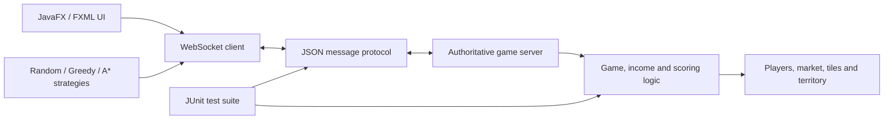

# Multiplayer Tile Game — Java Client–Server Portfolio

[](https://openjdk.org/)
[](https://openjfx.io/)
[](https://maven.apache.org/)
[](../../actions/workflows/tests.yml)

A source-code portfolio edition of a university software-engineering project: a networked multiplayer tile-placement game with a JavaFX client, authoritative Java server, JSON protocol, chat, automated players, and rule validation.

The original academic project was inspired by the commercial board game *Isle of Skye*. This public edition focuses on software architecture and engineering work. Commercial artwork, audio, generated binaries, internal course material, and other redistribution-sensitive assets are intentionally excluded.

## Engineering highlights

- Client–server multiplayer architecture with WebSocket communication
- Explicit JSON message protocol and phase-driven state transitions
- JavaFX/FXML desktop interface with reactive game-state updates
- Room creation, lobby readiness, player colours, chat, and private messages
- Tile pricing, buying, placement validation, income, and scoring logic
- Random, greedy, and A*-inspired automated player strategies
- Recovery and validation for disconnects, invalid turns, and race conditions
- Unit tests for game rules, scoring, income, tile handling, and protocol messages

## Architecture



Package-level details are available in [docs/architecture.md](docs/architecture.md).

## My contribution — Duru Sert

My work concentrated on the JavaFX frontend and the boundary between the UI, network protocol, and multiplayer game state:

- Established the initial GUI structure and Main Menu → Lobby → Game navigation
- Built client-side protocol handlers and message dispatch in the lobby/controller layer
- Synchronized the Build, Discard, Reveal, Buy, Scoring, and Game Over phases with the UI
- Implemented private chat commands (`/w`, `/r`), help commands, and unread-message indicators
- Added active-player status, market labels, placement confirmation/undo, and rotation interactions
- Fixed disconnect handling, invalid turn transitions, ghost clients, scoring animation, and Game Over race conditions
- Contributed five-player support, UML artifacts, integration work, final testing, and UI polish

These areas are documented by the original private GitLab history. See [CONTRIBUTIONS.md](CONTRIBUTIONS.md) for a more detailed breakdown.

## Technology

| Area | Stack |
| --- | --- |
| Language | Java 24 |
| Desktop UI | JavaFX, FXML, CSS |
| Networking | Javalin WebSocket, JSON |
| Serialization | Gson, Jackson |
| Logging | SLF4J, Log4j 2 |
| Testing | JUnit 5, Mockito |
| Build | Maven Shade Plugin |

## Repository structure

```text
src/main/java/backend/       Game model, rules, AI and server
src/main/java/frontend/      WebSocket client and JavaFX controllers
src/main/resources/fxml/     UI structure
src/main/resources/styles/   Sanitized portfolio styling
src/main/resources/tiles/    Non-visual tile metadata used by the logic
src/test/java/               Unit tests
docs/                        Architecture documentation
```

## Verify the code

Requirements: JDK 24 and Maven 3.9+.

```bash
mvn test
```

To compile and create platform-specific distributions under `target/distributions/`:

```bash
mvn package
mvn -Pclient-mac-arm package
mvn -Pclient-mac-intel package
mvn -Pclient-windows package
```

## Portfolio-edition scope

This repository is intentionally not a redistributable game package. The original visual board, tile sheet, scoring artwork, music, sound effects, compiled JARs, and internal university documentation are not included. Their absence does not affect compilation or the unit-test suite, but the complete graphical game requires the original private project resources.

See [NOTICE.md](NOTICE.md) for the complete publication and attribution notice.

## Team context

The university project began with six students and was completed by the remaining five after one member left during development. This portfolio repository uses a clean publication history; the original private GitLab repository remains the source of truth for team authorship and commit attribution.

## License

No open-source license is granted for the collaborative project code. The repository is published for portfolio review and educational reference only. See [NOTICE.md](NOTICE.md).
